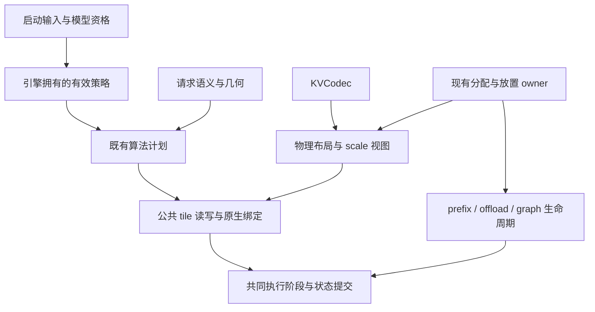

# KV 缓存与加速路径解耦审计及 INT8 实施方案

审计日期：2026-10-11。源码基线：`onecat/main`
`be3722bc095b9792bf9833068595f0b1ef70ad37`。
本次交付是框架审计和实施设计，没有增加运行时格式、修改路由或提升默认配置。
后续源码变化应重新核对受影响条目，不能把本文当作实时能力表。

## 结论与交付边界

可以把“新增 KV 格式”和“新增加速算法”的开发工作解耦，但当前只完成了部分基础。
Python 已有 `KVCodec`，Flash-V100 已拆分调度和执行模块；原生读写、缩放语义、
布局、分组验证、图策略及部分模型融合入口仍与具体格式绑定。
只注册一个 INT8 类，无法继承现有 FP8 加速链。

目标应是：**算法通过共同的缓存访问契约实现一次，格式实现编码、解码及布局一次，
由既有绑定与能力声明组合；新增算法自动获得符合契约的格式实例和验证用例。**
编译出的模板实例、真实硬件限制和必要的组合验证仍然存在，不再手工复制执行流程。
不同格式可以有不同分块和工作区预算；这是成本调优，不应成为不同业务流程。

FP16/BF16 是未压缩的存储格式。INT8 相比 FP16 有容量和带宽潜力，但会引入量化误差；
相对 FP8，速度取决于解码、缩放和访存成本，精度取决于分布、粒度、舍入与标定。
现有短请求数据支持继续开发 INT8，不能证明它在所有模型、长上下文或加速路径上更优。

| 范围 | 本次结论 | 尚不能宣称 |
| --- | --- | --- |
| 正确性支持范围 | 盘点配置中的全部 KV 格式、SM70 主要算子族及缓存生命周期边界；保留已有硬件和语义约束 | 全部格式在 V100 可运行，或任意参数组合均已验证 |
| 计划加速子集 | 首先让常规分页 K/V 的 INT8 进入 FP16/E4M3/E5M2 复用的算法族，再闭合其余入口 | BF16、MLA、TurboQuant 自动获得同一原生实现 |
| 本次测量 | 源码审计、286 项通过的 CPU 检查、1 项基线失败；复用此前误差证据 | INT8 原生 GPU 正确性、模型质量、吞吐或延迟提升 |

“完整”指框架各责任边界和实施范围已列明，不表示逐个原生模板或所有配置组合已运行。
沿用[开发契约](../../contributing/1cat-development.md)和
[架构所有权](README.md)，不创建第二套调度器、配置中心或缓存分配器。

## 1. 当前格式并没有进入同一套契约

配置入口见 [`CacheDType`](../../../vllm/config/cache.py)。
[`KV_CODECS`](../../../vllm/v1/attention/kv_codecs.py)只有四个对象，
[`KVQuantMode`](../../../vllm/v1/kv_cache_interface.py)另行描述量化模式。
两者各自有用途，但新增格式时容易只更新其中一条链。

| 配置格式／家族 | 当前表示及入口 | 统一工作的边界 |
| --- | --- | --- |
| `auto`、`float16` | 通用 codec 中为 FP16，原生标识为 `auto` | 在初始化解析实际模型／缓存 dtype；不可把所有后端的 `auto` 永久当作 FP16 |
| `bfloat16` | 有 BF16 codec，Flash-V100 原生常规读者只列 FP16/E4M3/E5M2 | 保留适用后端／回退，不把有 descriptor 当成原生支持 |
| `fp8`、`fp8_e4m3`、`fp8_e5m2` | 常规路径用 uint8 payload、逻辑 FP8 元素和标量 K/V scale | 现有原生加速重点；别把所有 uint8 都解作 FP8 |
| `int8_per_token_head` | Triton 已有有符号 INT8、每 token/head 的 FP32 scale 读写 | 不在 `KV_CODECS`；尚未进入 Flash-V100 原生公共契约 |
| `fp8_per_token_head` | Triton 的逐 token/head 缩放模式 | 与标量 FP8 具有不同 scale 地址及计算语义，也需公共契约 |
| `fp8_ds_mla` | MLA 压缩潜变量及 RoPE 的专用布局；部分 MLA 后端把 `fp8` 当作该格式别名 | 表示层不同；别名要在表示／后端上下文中解析，不能全局硬改成普通 E4M3 |
| `nvfp4` | FlashInfer 的打包 FP4 和块 scale 布局 | 保留 provider 的硬件／算法限制，不宣称 V100 支持 |
| `fp8_inc` | 配置保留的 Gaudi/HPU 格式入口 | 纳入格式身份和显式能力拒绝；本次不做该硬件资格验证 |
| `turboquant_k8v4`、`turboquant_4bit_nc`、`turboquant_k3v4_nc`、`turboquant_3bit_nc` | TurboQuant 专用后端，包含变换、码本／范数等计算 | 可共享布局、生命周期、绑定与观测；不能假装只是普通字节转换 |
| 拟议 `int8_g64` | [G64 交接设计](int8_g64_codec.md)，未实现 | 通道组 scale 与 token/head scale 不同，必须有独立且版本化的格式身份 |

非普通 K/V 的依据分别见 [MLA](../../../vllm/v1/attention/backends/mla/flashmla_sparse.py)、
[NVFP4](../../../vllm/v1/attention/backends/flashinfer.py)和
[TurboQuant](../../../vllm/v1/attention/backends/turboquant_attn.py)。
统一的是描述和接入契约，表示层仍可声明不同算法需求。

## 2. 已确认的耦合和处理优先级

以下是基线源码事实；涉及运行后果的推断明确列出。P1 表示 INT8 接入前必须解决，
P2 表示闭合加速复用时必须解决，并非本次已修复的缺陷。

| 优先级／边界 | 证据与问题 | 实施要求 |
| --- | --- | --- |
| P1：准入与兜底 | [`backend.py`](../../../vllm/v1/attention/backends/flash_v100/backend.py)继承 Triton 的格式声明；[`impl.py`](../../../vllm/v1/attention/backends/flash_v100/impl.py)的 `_supports_flash_v100_path` 用“非 FP8 或已知 FP8”放行；INT8 会通过这层检查 | 后端宣告能力、实际绑定和兜底使用同一有效格式契约 |
| P1：兜底未经格式检查 | [`select_route`](../../../vllm/v1/attention/backends/flash_v100/routing.py)返回指定 fallback 时只检查其 fallback 标记；[`ScalarDecode.admit`](../../../vllm/v1/attention/backends/flash_v100/decode.py)恒为真；原生 parser 只识别三种格式 | 不能用不兼容的 scalar native 路径兜底；转入已合格的通用实现或明确拒绝 |
| P1：scale 表达不完整 | `KVCodec.dequantize` 只收标量 scale；`quantized` 的注释也限定 per-tensor | 显式表达 K/V 独立粒度、scale 类型、地址和计算位置 |
| P1：原生读者重复且固定布局 | [`flash_decode_paged.cu`](../../../flash-attention-v100/kernel/flash_decode_paged.cu)与 [`grouped-attention.cu`](../../../csrc/attention/sm70_grouped_long/kernel/grouped-attention.cu)各有 FP8 读取／转换；向量读取存在按 8／16 字节分组的地址假设 | 一个原生 codec 访问层；访问层处理物理 stride、对齐和尾部，算法不推算格式地址 |
| P1：写者与融合入口 | [Triton writer](../../../vllm/v1/attention/ops/triton_reshape_and_cache_flash.py)、[原生 cache writer](../../../csrc/libtorch_stable/cache_kernels.cu)、[QK/RoPE 融合](../../../vllm/model_executor/layers/attention/sm70_qwen38_qk_rope.py)各有格式逻辑；融合写缓存仅准入 E4M3 等特定几何 | 共用编码和布局语义；单独写与融合写必须产出兼容的缓存，不为 INT8 复制整条融合流程 |
| P1：分配与数据视图 | [`AttentionSpec`](../../../vllm/v1/kv_cache_interface.py)预算逐 token/head scale；[`triton_attn.py`](../../../vllm/v1/attention/backends/triton_attn.py)用额外 4 字节容纳 FP32 scale 并建立 typed views | payload、scale、padding、页 stride 从一个物理契约导出，仍由现有 owner 分配 |
| P2：算法与格式准入混合 | `ROUTE_SPECS` 同时保存 codec 集合与几何；XQA、E4M3/E5M2 分块、长上下文阈值存在单独条件 | 分开算法语义、已编译绑定、质量资格和成本调优；历史限制有证据后才放宽 |
| P2：grouped／验证分叉 | [`sm70_grouped.py`](../../../vllm/v1/attention/ops/sm70_grouped.py)中 FP16/E4M3 有不同 op、group 上限及 ABI；[verifier](../../../vllm/v1/attention/backends/flash_v100/spec/verifier.py)再选格式路径 | 公共分组算法配 codec；保留 FP32 等数值策略，以及树 mask、接受与回滚契约 |
| P2：图与默认策略 | [`graph_policy.py`](../../../vllm/platforms/sm70/graph_policy.py)按 FP8 类型建立上下文桶／wave；[模型默认](../../../vllm/model_executor/models/runtime_defaults.py)还保留 E4M3 专项资格条件 | 图能力来自已绑定算法、容量及稳定地址；格式影响资源成本，但不新增一套 INT8 图流程 |
| P2：QSA／host | [QSA](../../../vllm/models/qwen4_exp/nvidia/qsa.py)限制格式；[host history](../../../vllm/models/qwen4_exp/nvidia/ops/host_kv.py)有自己的 E4M3 编解码、逐向量 scale、FP16 hot cache | 把存储 codec 与主机／设备放置分开；设备 E4M3 标量 scale 和 host E4M3 动态 scale 不能混为一个契约 |
| P2：其他稀疏表示 | [SM70 sparse MLA](../../../vllm/models/deepseek_v4/sm70/sparse.py)、[融合插入](../../../vllm/models/deepseek_v4/sm70/qnorm_rope_kv_fp8_insert.py)、[indexer](../../../vllm/models/deepseek_v4/sm70/indexer.py)直接理解打包 FP8、RoPE 及 index scale | 单独声明潜变量／index 表示；在各自算法族内复用 codec，不能套普通 K/V shape |

准入问题的具体触发条件是：强制 Flash-V100、使用 INT8、原生算子已加载，并进入原生
decode 选择。XQA 因未知 codec 不被选中，scalar 兜底仍可收到 INT8；原生实现最终有
unsupported-dtype 检查。这是源码可达性发现，未做 GPU 启动复现，也没有声称数据已静默损坏。
因此“通用 Triton 有 INT8”不等于“强制 Flash-V100 会自动安全回退”。

两个必须在设计中解决的具体例子：

1. 当前 INT8 `D=256` 的 payload 加 FP32 scale 为每 head 260 字节。
   直接复用假设 stride 可被 8／16 整除的 FP8 向量读取会违反布局前提。
   应选择合法 padding 或字节地址访问，不能删掉对齐检查。
2. 标量 K scale 可合并进 QK 系数，标量 V scale 可在最终输出乘回。
   token/head 的 K scale 要按 key 行应用；V scale 必须进入各 token 的加权和。
   通道组 K scale 要在相应通道组归约时参与。`sum(P[t] * V[t] * sV[t])`
   一般不能改写成一个全局 scale 乘最终输出。仅共享 `load<uint8>` 不足以复用算法。

## 3. 加速链的覆盖台账

静态枚举为 57 个具名 route 声明，另有动态诊断名称族；其中 8 个标记 observer、
9 个标记 fallback，两类可重叠。它们不是 57 个独立 GPU kernel。
codec 集合分布为：FP16/E4M3/E5M2 20 项，加 BF16 12 项，FP16 专项 15 项，
E4M3 专项 5 项，双 FP8 4 项，E5M2 专项 1 项。
完整名称和条件以[源码导出的参考表](runtime_reference.md)及 `ROUTE_SPECS` 为准。
部分 FP16 声明描述已经转换的 dense 输入，不能据此断言它拒绝所有压缩缓存。

| 加速／执行家族 | 当前可复用部分 | 必须闭合的格式边界 |
| --- | --- | --- |
| Scalar paged decode、XQA、分区／合并、compact tail | 页表、GQA、QK／softmax／PV、partition reduction | scalar／向量读者、scale 位置、实际绑定、合法兜底；compact tail 的 E4M3 限制 |
| Small-query grouped FP32、mixed prefix/decode、DFlash2 verify | 分组元数据、请求行映射、归约流程 | K/V codec、FP32 数值策略、group 容量和 speculative 状态 |
| 常规 paged prefill、prefix、split-KV、BHMD／contiguous | 相同 attention 语义及既有调度 | 原生读者或显式 gather/conversion；非连续页、尾部与 mask |
| Dense Split-D、D256 各变体、splitkv3、固定 FlashInfer-SM70 入口 | 已准备好 FP16 张量后的计算 | 用有界 codec bridge 接入缓存；不能把 dense FP16 算法改名为直接 INT8 算法 |
| FP8 bridge 和 dense reference | 临时张量与有界转换的思路 | 通用 codec 转换；记录转换成本和 fallback，避免每步解压整个历史缓存 |
| Triton unified attention／安全回退 | 已支持逐 token/head scale 的统一算法 | 归并格式身份、布局与 writer 契约；证明每个回退确实消费该格式 |
| SWA、prefix anchor、DDTree 非因果／树 mask | mask 和请求语义 | 保留实际限制；不能因为 codec 注册就放开未支持的语义组合 |
| QSA page4、top-k gather、压缩历史、host hot cache | 索引选择、组装和生命周期 | raw／compressed／hot／host 的不同物理视图；payload 与 scale 同步搬运 |
| MLA paged split-K／BMM、indexer、TurboQuant | 各自算法族及公共资源边界 | 表示／查询变换有真实差异；在族内组合格式，不复制全模型 |
| 融合 norm／RoPE／KV 写入 | norm、RoPE 和写入调度 | 编码、scale 计算及地址通过公共契约；未合格融合退回公共写者 |
| CUDA Graph、chunked prefill、prefix reuse、TP／DCP、host offload | 调度、通信、分配及状态 owner | 图容量、字节复制、跨进程描述、缓存命名空间及状态恢复包含有效 codec |
| Linear／LM-head、MoE、GDN、一般通信 | 既有 family selector、权重 codec 和计算 stages | 不添加 KV 格式条件；审计模型默认和图策略带来的间接影响 |

对 linear／LM-head／norm kernels、SM70 MoE selector／stages 和 GDN selector 的
入口检查未发现直接按 `kv_cache_dtype`／`kv_codec`／`kv_quant_mode` 分派。
MoE 已有与权重量化解耦的 stage plan；GDN 管理 recurrent state，不是普通 K/V cache。
这些是应保留的边界，不需要为 INT8 重写。它们仍会受整体显存预算、图容量及模型资格
间接影响，不能据此宣布整个执行栈与 KV 已完全无关。

缓存搬运也不能遗漏：通用 [CPU offload](../../../vllm/v1/kv_offload/cpu/gpu_worker.py)
按 physical page 字节复制，而不是重新计算 scale；
[KV transfer](../../../vllm/distributed/kv_transfer/kv_connector/)
具有远端 dtype／布局协商边界。内联 scale 可随整页移动，独立 scale 张量必须显式进入
搬运描述。跨节点不认识新布局时应拒绝或使用合格转换，不能只比较 payload dtype。

[现存限制](flash_v100_known_issues.md)还记录了 DDTree E4M3 capture、FP16-only
prefix-anchored SWA 等历史问题。本文保留这些限制；它们不是此次新增 INT8 的成功覆盖。

## 4. 目标架构：扩大公共契约，保留现有 owner



这是责任划分，不要求新增六套类层次。优先扩展现有 `KVCodec`、缓存 spec/view、
`RouteSpec`、native bindings 和 execution plan；`KVQuantMode` 作为兼容入口，
其含义由共同格式契约一致导出，不能继续独立添加第二份事实表。

| 契约 | 必须表达 | 不应承担 |
| --- | --- | --- |
| 格式身份 `KVCodec` | payload 类型、K/V scale 粒度与类型、packing、舍入、饱和、编码版本、参考编解码 | 模型名称、TP 白名单、decode/prefill 主流程 |
| 物理 cache view | payload/scale 基址、字节 stride、页形状、有效范围、对齐与 padding；可描述不同 K/V 布局 | 分配新资源 owner、复制整个缓存、决定请求 mask |
| 算法及数值策略 | attention 表示、mask、几何、QK/PV 计算精度、累加／归约规则 | 格式字符串判断、从 dtype 猜 scale 地址 |
| 原生绑定／能力 | 算法 × codec 实例、ABI、已加载符号、设备／布局支持、拒绝原因 | 仅凭 Python registry 宣告可执行 |
| 调优策略 | 有效几何、实际 bytes、scale 成本、设备资源、partition 与 workspace 选择 | 为每个 INT8 特性增加启动开关或复制执行链 |
| 生命周期 | 配置／编译缓存身份、图地址与容量、分配／搬运、提交回滚、请求隔离 | 以环境变量或 import 顺序暗中选择数值策略 |

原生使用编译期 codec/traits，按页／tile 加载与解码；不能在每个元素上做虚函数分派。
旧 FP8 的标量折叠可作为明确的数值策略保留；INT8 的逐行／逐组 scale 应在正确阶段
参与计算。共享接口不要求改变既有 FP8 舍入，也不能把所有路径先强行 cast FP16。
FP16、BF16、FP32 中间精度必须由算子契约决定。

新增算法通过公共 tile 契约编译所有**已声明适配该表示**的 codec；新增 codec 提供
对应读写和布局即可实例化已有算法。算法若需新能力（如查询旋转），在能力契约中
声明原因；缺失实例被构建／绑定检查发现。历史 route 名保留作兼容观测标签，
不再充当数值与存储策略的唯一身份。扩展现有声明和生成工具，不另建运行时 registry。

图计划仍由既有 dispatcher 管理。把 codec 的物理容量和数值策略纳入有效编译／资源
身份，预先分配 scale 和工作区，验证变长 replay。模型权重量化不能替代 KV 身份；
draft 和 target 可使用不同 codec，应分别绑定状态与元数据。

## 5. INT8 格式选择与已有证据

建议第一条实现使用**每 token/head 的 FP32 scale**建立完整纵向路径，再决定 G64
或 K/V 不对称粒度。理由是已有通用布局与读者可以作为参考，scale 只依赖本次写入，
不需修改历史 token 组。最先闭合原生算法复用，避免同时引入跨 token 重量化和残差状态。

新候选参考编码为 `s = max(absmax(x) / 127, 1e-6)`，
`q = clamp(round_to_even(x / s), -128, 127)`，解码为 `q * s`。
scale 用 FP32 保存，K/V 分别计算；尾部 mask、零向量、异常值处理和 native 舍入
必须成为书面契约。现有 Triton 写者直接转换整数，历史比较显示其截断与最近偶数舍入
误差不同。不能无声替换 `int8_per_token_head` 的缓存字节语义：先建立兼容版本与
缓存复用隔离，再依据数值／任务证据决定是否升级默认编码。

下表复用 [#1048 的 27B 请求分析](https://github.com/1CatAI/1Cat-vLLM/blob/847bb3d8eb66b395f3e7910c3ac66953eb6bd619/docs/design/sm70_kv_initial_request_errors.md)
及 [Flash-Next 分析](https://github.com/1CatAI/1Cat-vLLM/blob/847bb3d8eb66b395f3e7910c3ac66953eb6bd619/docs/design/sm70_kv_flashnext_request_errors.md)，
不是本次新测量。指标是相对捕获 FP16 Q/K/V 的 FP32 masked-attention oracle 的平均 RMSE。

| 候选 | 27B NVFP4 权重 | 27B GGUF 权重 | Flash-Next IQ3_XXS 权重 |
| --- | ---: | ---: | ---: |
| E4M3，捕获层 scale | 0.0370931 | 0.0422691 | 0.01095393 |
| INT8 token/head，FP32 scale，最近偶数舍入 | 0.0160022 | 0.0158804 | 0.004157149 |
| INT8 token/head，旧截断 | 0.0437854 | 0.0434619 | 0.01143756 |
| INT8 通道 G64，FP16 scale | 0.0112148 | 0.0107758 | 0.002915484 |

前两组分别为 TP2 的 6 个层／rank 样本，后一组为 TP4 的 12 个样本；各自只覆盖一个
157-token 请求，层／rank 不是独立请求。诊断使用 V100、FP16 KV、eager、无 MTP／
prefix reuse。27B 记录为 Torch 2.10.0+cu128／CUDA 12.8；具体源版本与 artifact
见原始记录。E4M3 使用从 FP16 路径捕获的层 scale，**没有独立校准生产 FP8**。
Flash-Next 只覆盖 ratio4，且短请求全部因果历史都被选中，未覆盖 top-k 剪枝或 ratio128。
没有据此得到任务质量、自然 EOS、接受率、长输出漂移或服务速度结论。

[极值检查](https://github.com/1CatAI/1Cat-vLLM/blob/847bb3d8eb66b395f3e7910c3ac66953eb6bd619/docs/design/sm70_kv_error_ablation.md)
还发现：`65504 / 127` 保存为 FP16 scale 后可变成 `516`，
`127 * 516 = 65532` 转 FP16 会溢出。G64 的 FP16 scale 必须明确舍入／饱和规则，
不能因为短请求都有限就直接提升。K/V 不同粒度也应由数据决定；
[KIVI 论文](https://arxiv.org/abs/2402.02750)说明二者分布可以不同，但它的 2-bit 结果
不构成本项目 INT8、模型或硬件的资格证明。

仅作布局预算示例：`D=256` 时，每 token、每 KV head 的 K+V，FP16 为 1024 字节；
INT8+两份 FP32 token/head scale 为 520 字节；G64+FP16 scale 为 528 字节，
G64+FP32 scale 为 544 字节。FP8 payload 同样为 512 字节，另有其 scale 成本。
这些数值不含页对齐、Mamba 混合分组 padding、热缓存和工作区，不能直接当作显存实测。
在 V100 的现有 attention 中，INT8 存储也不自动变成整数 QK/PV 计算。

## 6. 分阶段实施及复用已有工作

原生共享读者已有两个未合并的 Draft：
[#1048](https://github.com/1CatAI/1Cat-vLLM/pull/1048)（审计 head `847bb3d8eb`）
提取 CUDA／Triton 读写及存储计量；
[#1061](https://github.com/1CatAI/1Cat-vLLM/pull/1061)（`1b81240416`）
提取 FP16/E4M3/E5M2 CUDA traits。
[#1063](https://github.com/1CatAI/1Cat-vLLM/pull/1063)（`240b9ac66c`）
提出按已加载原生能力选择 bridge。这些分别有 CPU／静态编译证据，不能当成已合入
当前主线或已验证 INT8。移植可复用部分到当前 A3 所有权结构，避免恢复旧的单体后端，
也不新增平行的 Python codec registry。bridge 的选择变化仍需独立数值和性能证据。

| 阶段 | 具体改动与责任入口 | 可审阅交付／退出条件 |
| --- | --- | --- |
| 0：锁定契约与准入 | `kv_codecs.py`、`kv_cache_interface.py`、backend 声明、`routing.py` 和 native capabilities | 分清格式／表示／舍入版本；复现并修复 INT8 误入 native fallback；所有未知组合可解释地拒绝或回退 |
| 1：公共物理访问层 | 复用既有 Draft 的 codec 读写思想；覆盖 CUDA/Triton writer、byte accounting 和 typed views | FP16/E4M3/E5M2 保持原有契约；一个布局来源，兼容旧符号／alias；无第二资源 owner |
| 2：INT8 最小纵向闭环 | token/head FP32 scale writer、reader、绑定；公共 scalar／XQA 调度与归约通过 codec 实例化 | 实际 GPU 读写、注意力结果、非连续页和 graph replay 通过；有合格回退；先得到原生成本和代表性质量决策 |
| 3：闭合常规加速族 | grouped／mixed／verify、prefill／Split-D bridge、融合写入；分离图容量与格式专项条件 | 第 3 节每个常规族有 native／显式 bridge／拒绝条目及证据，不留下每格式执行流程；MTP 接受／回滚和 draft/target 独立 |
| 4：闭合放置与特殊表示 | QSA raw/compressed、host hot cache、prefix／offload／KV transfer；稀疏 MLA、indexer、TurboQuant 的族内契约 | 全部 payload/scale 同生命周期；各族明确支持范围和拒绝原因，不把常规 INT8 冒充 MLA INT8 |
| 5：质量、性能与交付 | 普通入口、source build／wheel、匹配工作负载 A/B；依据收益决定 G64／非对称粒度 | 输出支持／加速／已测三张清单；达到质量门槛后才推广默认；保留 35B AWQ 与 FP8 路线的同条件纯 decode 要求 |

阶段 2 后即可形成有边界的可用 INT8 实现，避免在没有原生成本证据时继续大范围改造；
但“复用所有既有 FP8 加速链”的交付必须继续完成阶段 3／4，不能以单一路由命中代替。
G64 不阻塞基础统一工作。每个阶段沿用受影响组件的测试及声明；无关算法不重写。

## 7. 用契约验证取代人工参数笛卡尔积

不能承诺“无需验证任何参数组合”。可把手工适配从路径 × 格式 × 功能的扩张，降为
算法契约、codec 契约和自动生成的绑定验证；边界和状态交互仍需针对性覆盖。
下列测试由对应修改触发，不要求每次都启动所有大模型。

| 层次 | 最小必要检查 | 发现的问题由谁负责 |
| --- | --- | --- |
| Codec 单独验证 | 零值、舍入边界、极值／非有限值、scale 粒度、K/V 不同布局、尾部／padding、写后读 | codec 数值与物理布局 |
| 算法单独验证 | 公共参考 tile 上的 QK/PV、mask、归约、empty／边界行；保留声明的计算精度 | 算法／数值策略 |
| 自动绑定矩阵 | 从现有声明生成每个已准入算法 × codec 的小型 GPU 用例；缺符号、旧 ABI、未实现格式的拒绝／回退 | 绑定与构建；不能仅断言 selector 返回名称 |
| 受影响几何 | 实际阈值的有效相邻点和区间内部；D／GQA、页大小、分区数、chunk 尾部、容量／padding、非连续页 | 负责该限制的算法或布局 |
| 状态交互 | prefix 命中／未命中、块复制／换出恢复、SWA、MTP accept/reject、请求换序／取消／槽复用、不同 codec 的两个引擎 | allocator／runner／state owner |
| 启动与图 | Python API／CLI 等效有效输入、V1/V2 受影响入口、eager／capture／变输入 replay、冷／暖配置和编译缓存、正常 wheel 加载 | 配置、图和 artifact owner |
| 模型质量 | 先定义算子/dtype 误差界和任务容许差；配对检查非有限值、长输出漂移、检索／任务正确率、重复／EOS、MTP 接受率 | 模型资格；不靠“看起来流畅”放行 |
| 性能 | 同模型、权重格式、TP、GPU、有效长度、输入／输出 token 数、采样／MTP、后端、图状态；分别测转换、attention、TTFT/prefill、纯 decode | 调优与端到端性能资格 |

上下文长度必须写明单位是原始输入 token、压缩后 KV 行数还是 index 选择数；图容量
另记 padding 后大小。固定 page4／GQA6／D256 的证据不能外推所有几何。
权重量化、LoRA、TP/DCP、推测宽度等参数，只有确实改变相关张量／状态契约时才增加
针对性测试；不再按型号／格式手工新增一个专用执行分支。

无数值变化的抽取保留适用的存储、状态和确定性结果契约；真正的数值改动允许事先
定义的 operation/dtype-aware 误差和配对任务质量容许差，不把 token 完全一致作为
默认唯一标准。显式 bit-exact API、缓存字节、索引／mask、请求隔离及回滚仍须严格保持。
失败阈值不能为了通过而临时放宽，baseline 本身的变动应单独记录。

35B-A3B 的 AWQ／FP8 权重路线仍需与 0.0.3 同条件纯 decode 基线比较；
27B 或 Flash-Next 的 route smoke 不能代替。KV 格式的比较应明确是否改变实验变量，
不能把权重量化、MTP 或 GPU 数变化带来的收益算给 INT8。

## 8. 本次检查、保留问题与完成判据

在上述干净 worktree 基线进行 CPU 检查，关闭 GPU 可见性和使用统计，线程数固定为 1。
复现时 `.venv` 应指向包含 Torch 的项目虚拟环境；本次复用了已有运行环境，未安装依赖：

```bash
export CUDA_VISIBLE_DEVICES='' VLLM_NO_USAGE_STATS=1 PYTHONDONTWRITEBYTECODE=1
export OMP_NUM_THREADS=1 OPENBLAS_NUM_THREADS=1 MKL_NUM_THREADS=1
.venv/bin/python -m pytest -q -p no:cacheprovider --confcutdir=tests/v1/attention \
  tests/v1/attention/test_kv_codecs.py
.venv/bin/python -m pytest -q -p no:cacheprovider --confcutdir=tests/v1/attention \
  tests/v1/attention/test_flash_v100_routes.py \
  tests/v1/attention/test_sm70_grouped_codecs.py
.venv/bin/python -m tools.generate_architecture_reference --json
.venv/bin/python -m tools.sm70.flash_v100_audit
```

codec 测试 10 项通过，routes/grouped 276 项通过、1 项失败。
失败项 `test_native_loading_workspace_and_scalar_long_calculations_match_parent`
比较历史 AST hash；当前主线的 `sm70_fp16_grouped._run` 与四个
`sm70_grouped_long` 函数已不同于 fixture，涉及后续资源／策略所有权修改。
这是修改任何本次文档前就存在的基线失败；不重写 fixture 使它“通过”，也不据此
判定原生数值已回归。实现阶段需由相关组件核对历史契约并补充行为证据。

架构导出读到 4 个 codec、57 个 route 声明。Flash-V100 所有权审计为 import cycle 0、
spec 外模型名称 0、config 外环境读取 0，仍有 11 处跨模块 private 引用；最大 active
函数 200 行，deferred DDTree 函数 321 行。这说明模块整理已经发生，不能据此认定
原生格式解耦完成。本次没有 GPU 构建、原生计时或模型质量实验。

文档验证包括新增报告的本地链接检查、架构参考一致性检查，以及四个文档文件适用的
pre-commit hooks，均通过；没有修改检查阈值或加入新的运行时测试。

实施完成需同时满足：

- 增加一种常规 KV codec 不再改写每条 attention 执行流程；增加算法不再复制格式分支。
- 全部读者、写者、融合、搬运和状态路径遵守同一个物理／数值契约，scale 不丢失或串用。
- 第 3 节各族均有能力与证据条目；原生执行、转换复用、通用回退与明确拒绝分别标识。
- 有效相同的启动配置得到相同计算策略；无隐藏 import 顺序或私有预加载依赖。
- 覆盖已受影响的图／请求／状态边界；数值、质量和同条件性能证据分别通过。
- 旧 FP8／FP16 加速回归和 35B 既定验收未被短测或“统一接口已存在”替代。

不再重复的方向：只新增 dtype／类；把 INT8 伪装为 E4M3；每种格式复制调度；
每步将全历史解压为 FP16 并称为 INT8 加速；批量删除几何／质量限制；
按短请求 RMSE 或单一路由命中选择默认格式；用元数据支持表冒充已执行证据。
